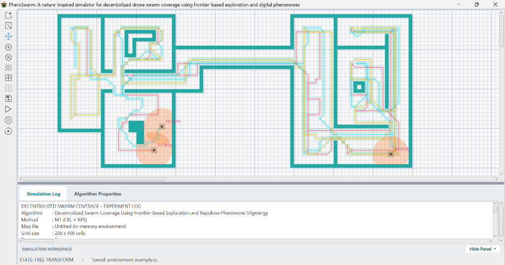

# PheroSwarm: Nature-Inspired Decentralized Drone Swarm Simulator

[](https://www.oracle.com/java/)
[](https://openjfx.io/)
[](https://maven.apache.org/)
[](https://fossalgo.github.io/pheroswarm/)
[](LICENSE)

**PheroSwarm** is an interactive, bio-inspired simulation platform designed for multi-agent autonomous exploration and coverage in complex, unknown indoor environments. It integrates **Frontier-Based Exploration (FBE)** with **Repulsive Pheromone Stigmergy (RPS)**, enabling decentralized drone swarms to collaboratively map environments, avoid redundant visitations, and minimize mutual interference without centralized coordination.

---

## 📸 Graphical User Interface & Simulation Overview

Below is a snapshot of **PheroSwarm** simulating multi-drone decentralized coverage in an interconnected indoor partitioned environment:

<p align="center">
  
</p>

*The visual workspace displays real-time 8-connected grid navigation, drone trajectories, sensing ranges, dynamic obstacle boundaries, repulsive pheromone distributions, live simulation metrics, and algorithm runtime parameters.*

---

## 🌐 Official Javadoc & API Documentation

Detailed class hierarchies, package architectures, algorithms, and method references are deployed and browsable via GitHub Pages:

👉 **[https://fossalgo.github.io/pheroswarm/](https://fossalgo.github.io/pheroswarm/)**

> **Note:** The documentation provides full interactive search indexing, inheritance trees, and comprehensive member specifications generated in compliance with Oracle Javadoc standards.

---

## 🔬 Core Concepts & Algorithmic Capabilities

PheroSwarm simulates realistic constraints for aerial robotic agents operating in GPS-denied and communication-constrained spaces:

1. **Frontier-Based Exploration (FBE):**
   - Agents identify boundaries between explored free space and unexplored areas (frontiers) from their independent local occupancy grids.
2. **Repulsive Pheromone Stigmergy (RPS):**
   - Drones deposit virtual repulsive pheromone markers along visited cells and active paths.
   - Pheromones dynamically evaporate ($\rho$) and penalize frontier cost functions ($\lambda$), naturally driving other swarm members away from recently explored sectors and eliminating redundant clustering.
3. **Decentralized Coordination:**
   - Drones operate without a central orchestrator. Each agent independently plans optimal collision-free trajectories using 8-connected A* / Dijkstra variants over local occupancy evidence grids.
4. **Collision Avoidance & Recovery Protocols:**
   - Built-in dynamic collision resolution, deadlock mitigation, and alternative route discovery when target frontiers become exhausted or blocked.
5. **Interactive CAD / Grid Environment Editor:**
   - Direct tools for creating, transforming, saving, and loading structured maps (cells, obstacles, corridors, and doorways).
6. **Detailed Metrics & Trace Diagnostics:**
   - Quantitative evaluation covering coverage percentage over time, total traveled path length, overlapping coverage ratios, collision counts, and CSV trace exports.

---

## 📁 Source Code & Module Architecture

The project codebase is organized cleanly under the `fosalgo.pheroswarm` module:

```text
pheroswarm/
├── assets/
│   └── images/
│       └── pheroswarm_simulator_screenshot.png  # GUI screenshot
├── docs/                                        # GitHub Pages Javadoc deployment
│   ├── .nojekyll
│   ├── index.html                               # Entry redirection
│   └── javadoc/                                 # Full HTML Javadoc site
├── src/main/java/
│   ├── module-info.java                         # Java module definition
│   └── fosalgo/pheroswarm/
│       ├── Launcher.java                        # Non-JavaFX entry point for executable JAR
│       ├── MainView.java                        # Primary JavaFX UI stage and toolbar controls
│       ├── CanvasView.java                      # Interactive grid rendering, agents, & pheromones
│       ├── DecentralizedExploration.java         # Core FBE + RPS algorithmic simulation engine
│       ├── ExplorationConfig.java               # Immutable record for simulation & pheromone hyperparameters
│       ├── AlgorithmPropertiesPane.java         # Real-time parameter inspection & tuning UI
│       ├── Drone.java                           # Drone state model (position, range, battery, trajectory)
│       ├── Point.java                           # Immutable 2D integer coordinate representation
│       ├── State.java                           # Application editor & simulation state machines
│       ├── CSS.java                             # Modern stylesheets & theme styling
│       └── SVGIcon.java                         # Scalable vector graphics for toolbar icons
├── src/main/resources/                          # Application assets and icon resources
├── pom.xml                                      # Maven POM with Maven Shade Plugin configuration
└── README.md
```

---

## ⚙️ Key Algorithm Hyperparameters

The simulation behavior can be tuned through `ExplorationConfig` directly from the UI or programmatically:

| Parameter | Type | Default | Description |
| :--- | :---: | :---: | :--- |
| `maxSteps` | `int` | `10,000` | Maximum synchronous time steps allowed per simulation run. |
| `stallLimit` | `int` | `50` | Maximum consecutive idle steps before triggering recovery routines. |
| `lambda` ($\lambda$) | `double` | `1.0` | Weight of the digital pheromone penalty in frontier utility scoring ($\lambda = 0$ corresponds to pure FBE baseline M0). |
| `rho` ($\rho$) | `double` | `0.01` | Pheromone evaporation rate per step ($0 \le \rho \le 1$). |
| `deposit` | `double` | `10.0` | Amount of repulsive pheromone deposited at visited cells upon successful moves. |
| `recovery` | `boolean` | `true` | Enables/disables frontier exhaustion alternate-move recovery strategies. |
| `traceFile` | `String` | `""` | File path for detailed step-by-step CSV diagnostic telemetry. |

---

## 🚀 Getting Started

### Prerequisites
- **Java Development Kit (JDK):** Version 24 or later (compatible with JDK 24).
- **Apache Maven:** Version 3.8+ (or use the bundled `mvnw` wrapper).

### 1. Clone the Repository
```bash
git clone https://github.com/fossalgo/pheroswarm.git
cd pheroswarm
```

### 2. Run from Source (Development Mode)
Run the application directly using the JavaFX Maven plugin:
```powershell
# Windows
.\mvnw.cmd clean javafx:run

# Linux / macOS
./mvnw clean javafx:run
```

### 3. Build Runnable Executable `.jar`
A standalone Fat/Uber JAR containing all JavaFX runtime modules and dependencies can be generated via:
```powershell
.\mvnw.cmd clean package -DskipTests
```
The executable binary will be generated at:
```text
target/pheroswarm-1.0.0.jar
```

### 4. Run Executable `.jar`
- **Double-click** the generated `pheroswarm-1.0-SNAPSHOT.jar` file in Windows File Explorer.
- Or launch it via terminal:
  ```bash
  java -jar target/pheroswarm-1.0-SNAPSHOT.jar
  ```

---

## 🛠️ Building in IntelliJ IDEA

1. Open **IntelliJ IDEA** $\rightarrow$ **File** $\rightarrow$ **Open...** $\rightarrow$ select the `pheroswarm` directory.
2. Ensure the Project SDK is set to **Java 21** or **Java 24** (*File > Project Structure > Project > SDK*).
3. To package the runnable JAR using the IntelliJ GUI:
   - Expand the **Maven** tool window on the right sidebar.
   - Go to **pheroswarm** $\rightarrow$ **Lifecycle**.
   - Double-click **`clean`**, then double-click **`package`**.
   - The runnable JAR is ready in the `target/` folder.

---

## 📑 Citation & Academic Reference

If you use **PheroSwarm** or its algorithmic components in your research, dissertations, or scientific publications, please cite:

```bibtex
@article{pheroswarm2026,
  title     = {PheroSwarm: A nature-inspired simulator for decentralized drone swarm coverage using frontier-based exploration and digital pheromones},
  author    = {Andi Amijoyo Mochtar; Rustan Tarakka; Sugiarto Cokrowibowo },
  journal   = { },
  year      = {2026},
  url       = {https://fossalgo.github.io/pheroswarm/}
}
```

---

## 📄 License

This project is licensed under the terms of the [MIT License](LICENSE). See the [LICENSE](LICENSE) file for full details.
